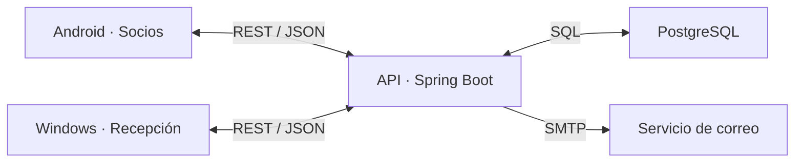

# Documentación técnica

## Arquitectura

Club Pádel Costa Brava es un sistema cliente-servidor. La aplicación Android,
desarrollada en Kotlin con Jetpack Compose, permite a los socios consultar
la disponibilidad y gestionar sus reservas. La aplicación Windows,
desarrollada en Java 21 con JavaFX, permite al personal de recepción
gestionar socios, reservas y bloqueos de pista.

Ambos clientes intercambian datos JSON con una API REST desarrollada en
Spring Boot. El servidor valida las peticiones, aplica las reglas del club,
accede a PostgreSQL y usa SMTP para enviar códigos de acceso y avisos de
cancelación.

## Organización y modelo de datos

El servidor organiza el código por funcionalidades, como autenticación,
socios, reservas, disponibilidad y bloqueos. Los controladores reciben las
peticiones HTTP, los servicios aplican las reglas de negocio y los
repositorios consultan y actualizan PostgreSQL.

Flyway aplica las migraciones de `server/src/main/resources/db/migration`
al arrancar. El [diagrama entidad-relación](modelo-er.drawio) es editable en
diagrams.net. El [esquema SQL de referencia](../database/esquema.sql)
describe las tablas y sus relaciones.

## Disponibilidad y reservas

El servidor usa la zona horaria Europe/Madrid para calcular los horarios
y los plazos de reserva. Aplica el horario correspondiente al día de la
semana o al festivo y calcula qué turnos están libres de reservas y bloqueos.
Se puede reservar para hoy y los trece días siguientes, antes de la hora de inicio.
Cada socio activo puede tener hasta dos reservas futuras confirmadas.

El servidor comprueba de nuevo la disponibilidad cuando se solicita una
reserva. Una reserva de dos horas genera una fila de reserva y dos filas
de ocupación. Se guardan dentro de una misma transacción, de modo que,
si falla una franja, se deshace la operación completa.

La clave primaria de `ocupacion` combina pista, fecha y hora. PostgreSQL
impide así que dos operaciones ocupen la misma franja. El servidor
también bloquea temporalmente la fila del socio al crear una reserva,
para aplicar el límite de reservas y evitar solapamientos del mismo
socio cuando llegan peticiones concurrentes.

Una cancelación conserva la reserva con estado `CANCELADA` y libera
las franjas que ocupaba. En las cancelaciones administrativas se registra
el motivo y se intenta avisar al socio por correo después de guardar el
cambio. Si falla el envío, la cancelación se conserva. Al inactivar un
socio se invalidan sus sesiones y se cancelan sus reservas futuras.
Si hay reservas afectadas, se intenta enviar un único correo de resumen.

## Seguridad

El servidor distingue los roles `USER` y `ADMIN`. Los clientes envían
un token de sesión en las peticiones protegidas y el servidor verifica
los permisos y, cuando corresponde, la titularidad de la reserva.
Las contraseñas y los códigos temporales se guardan mediante un hash
con PBKDF2. Los códigos son de un solo uso, caducan a los quince minutos
y tienen un límite de intentos.

La configuración de PostgreSQL, SMTP y el administrador inicial se
proporciona fuera del repositorio. La API desplegada en Railway utiliza
HTTPS. El [contrato de la API](api-rest.md) recoge las rutas y sus permisos.

## Pruebas y limitaciones

La suite del servidor incluye nueve casos automatizados sobre horarios,
disponibilidad, cancelaciones, paginación y fallos del correo. La
[guía de puesta en marcha](puesta-en-marcha.md) indica cómo ejecutarlos.

Los clientes se probaron manualmente. En Railway se comprobó el alta
y la activación por correo, el acceso como administrador y socio, y el
flujo integrado en el que una reserva creada desde el APK firmado de
Android apareció en la aplicación de Windows.

Las sesiones se guardan en memoria. Si se reinicia el servidor, los
usuarios deben volver a iniciar sesión. Los datos iniciales de festivos
corresponden a Roses en 2026 y deben actualizarse para años posteriores.

## Referencia del código

Desde `server` o `desktop`, ejecuta `.\mvnw.cmd javadoc:javadoc` para
generar el Javadoc del módulo Java correspondiente.

- Servidor: server/target/site/apidocs/index.html
- Windows: desktop/target/reports/apidocs/index.html

Desde `android`, ejecuta `.\gradlew.bat :app:dokkaGenerate` para generar
la referencia de Kotlin. La salida HTML está en `app/build/dokka/html/`.
Consulta la [guía de generación HTML con Dokka](https://kotlinlang.org/docs/dokka-html.html)
para ver las opciones de visualización.